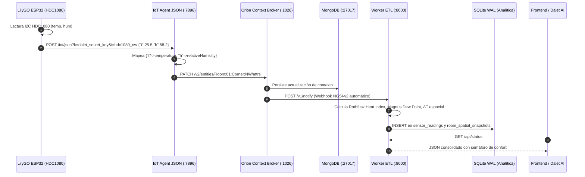

# 🏛️ Dalet-RoomAnalyzer — Documentación Técnica Integral de Arquitectura

> **Proyecto**: Dalet-RoomAnalyzer (Monitoreo Inteligente y Toma de Decisiones Ambientales para Salas).  
> **Estándar**: FIWARE NGSI-v2, IoT Agent JSON, Orion Context Broker, Pipeline ETL (Python/FastAPI) y PlatformIO Firmware.  
> **Infraestructura**: AWS EC2 (Ubuntu 22.04 LTS) + Docker Compose.

---

## 📑 Tabla de Contenidos
1. [Arquitectura Global y Flujo de Datos de Extremo a Extremo](#1-arquitectura-global-y-flujo-de-datos)
2. [Capa 1: Sensórica, Hardware y Firmware (PlatformIO)](#2-capa-1-sensórica-hardware-y-firmware-platformio)
3. [Capa 2: Pasarela de Ingesta y Traducción (FIWARE IoT Agent JSON)](#3-capa-2-pasarela-de-ingesta-y-traducción-fiware-iot-agent-json)
4. [Capa 3: Gestor de Contexto (FIWARE Orion Context Broker)](#4-capa-3-gestor-de-contexto-fiware-orion-context-broker)
5. [Capa 4: Pipeline ETL y Motor Analítico (FastAPI + SQLite WAL)](#5-capa-4-pipeline-etl-y-motor-analítico)
6. [Capa 5: Infraestructura Cloud en AWS EC2 y Docker Compose](#6-capa-5-infraestructura-cloud-en-aws-ec2-y-docker-compose)
7. [Catálogo de Tramas y Payloads de Red](#7-catálogo-de-tramas-y-payloads-de-red)
8. [Manual de Pruebas y Validación con Comandos cURL](#8-manual-de-pruebas-y-validación-con-comandos-curl)

---

## 1. Arquitectura Global y Flujo de Datos

El sistema adopta la arquitectura de referencia europea para ciudades y edificios inteligentes (**FIWARE**), garantizando el desacoplamiento total entre los sensores en el borde (*Edge*) y el procesamiento analítico en la nube (*Cloud*).

### 1.1 Diagrama de Bloques del Sistema

```text
       ┌──────────────────────────────────────────────────────────────┐
       │                 CAPA DE HARDWARE (EDGE)                     │
       │                                                              │
       │  4 Nodos LilyGO ESP32 / ESP8266 + HDC1080 (I2C)             │
       │  • Noroeste (Ventana)       • Noreste (Puerta)              │
       │  • Suroeste (Servidores)    • Sureste (Climatizador)        │
       │  [ WebServer Local :80 ]    [ Cliente HTTP Push :7896 ]     │
       └──────────────────────────────┬───────────────────────────────┘
                                      │
                                      │ 1. Trama Cruda HTTP POST :7896
                                      ▼
       ┌──────────────────────────────────────────────────────────────┐
       │              CAPA BROKER FIWARE (AWS EC2)                   │
       │                                                              │
       │  [ FIWARE IOT AGENT JSON (:4041 / :7896) ]                   │
       │    • Traduce {"t", "h"} a entidades NGSI-v2                  │
       │    • Valida API Key y Device ID                              │
       │                                                              │
       │  [ ORION CONTEXT BROKER (:1026) ] ◄──► [ MongoDB 5.0 ]       │
       │    • Mantiene estado vivo: Room:01:Corner:NW/NE/SW/SE        │
       │    • Gestiona Suscripciones reactivas (Webhooks)             │
       └──────────────────────────────┬───────────────────────────────┘
                                      │
                                      │ 2. Webhook NGSI-v2 /v1/notify
                                      ▼
       ┌──────────────────────────────────────────────────────────────┐
       │             CAPA ANALÍTICA Y DECISIÓN (ETL)                  │
       │                                                              │
       │  [ PIPELINE ETL (FastAPI :8000) ]                            │
       │    • EXTRACT:   Limpieza y filtrado de anomalías             │
       │    • TRANSFORM: Sensación Térmica (Fórmula Rothfusz/NOAA)    │
       │                 Punto de Rocío (Fórmula Magnus-Tetens)       │
       │                 Gradiente Térmico Espacial (ΔT = Tmax-Tmin)  │
       │                 Detección de tasa de cambio rápido           │
       │    • LOAD:      Persistencia en SQLite (Modo WAL)            │
       │                                                              │
       │  [ API REST (:8000/api/status, /api/history, /docs) ]        │
       │    • Alimenta Frontends de Gestión y Usuario                 │
       │    • Consultada por el Asistente por Voz con IA (Dalet)      │
       └──────────────────────────────────────────────────────────────┘
```

### 1.2 Diagrama de Secuencia Temporal de una Lectura



---

## 2. Capa 1: Sensórica, Hardware y Firmware (PlatformIO)

### 2.1 Especificaciones de Hardware
* **Microcontrolador**: LilyGO (ESP32-WROOM-32) o NodeMCU (ESP8266) con Wi-Fi 802.11 b/g/n (2.4 GHz).
* **Sensor**: Texas Instruments HDC1080:
  * Bus de comunicación: **I2C** (dirección esclava estándar: `0x40`).
  * Pines ESP32: `SDA = GPIO 21`, `SCL = GPIO 22`, `VCC = 3.3V`, `GND = GND`.
  * Rango de temperatura: $-40^\circ\text{C}$ a $+125^\circ\text{C}$ (precisión $\pm 0.2^\circ\text{C}$).
  * Rango de humedad: $0\%$ a $100\%$ RH (precisión $\pm 2\%$).
* **Distribución de Nodos (4 Esquinas)**:
  1. `hdc1080_nw`: Esquina Noroeste (Ventana / Fachada solar).
  2. `hdc1080_ne`: Esquina Noreste (Puerta de circulación).
  3. `hdc1080_sw`: Esquina Suroeste (Zona de servidores y equipos).
  4. `hdc1080_se`: Esquina Sureste (Zona climatizada / Flujo de aire acondicionado).

### 2.2 Estructura del Firmware en PlatformIO
Ubicación en el repositorio: [`firmware/`](file:///c:/Users/juans/Documents/Dalet-RoomAnalyzer/firmware/)
```text
firmware/
├── platformio.ini       # Definición de entornos y build_flags de esquinas
├── include/
│   └── config.h         # Parámetros Wi-Fi, host de AWS y sala
└── src/
    └── main.cpp         # Código C++ del nodo sensor (Dual Role)
```

### 2.3 Explicación del Código C++ del Nodo ([firmware/src/main.cpp](file:///c:/Users/juans/Documents/Dalet-RoomAnalyzer/firmware/src/main.cpp))

#### 1. Lectura I2C del sensor HDC1080:
```cpp
void readSensor() {
    float t = hdc1080.readTemperature();
    float h = hdc1080.readHumidity();

    if (!isnan(t) && !isnan(h) && t > -40.0 && t < 125.0) {
        currentTemp = t;
        currentHum  = h;
    }
}
```

#### 2. Empaquetado y Envío HTTP a FIWARE IoT Agent:
```cpp
void sendToFiware() {
    WiFiClient client;
    HTTPClient http;

    // URL Southbound del IoT Agent con API Key e ID de Dispositivo
    String url = "http://" + String(FIWARE_HOST) + ":" + String(FIWARE_PORT) +
                 "/iot/json?k=" + String(API_KEY) + "&i=" + String(NODE_ID);

    http.begin(client, url);
    http.addHeader("Content-Type", "application/json");

    // Construcción de la Trama JSON ultraliviana
    StaticJsonDocument<200> doc;
    doc["t"] = serialized(String(currentTemp, 2));
    doc["h"] = serialized(String(currentHum, 2));
    doc["presence"] = 1;
    doc["lat"] = serialized(String(ROOM_LAT, 6));
    doc["lon"] = serialized(String(ROOM_LON, 6));

    String payload;
    serializeJson(doc, payload);

    int httpCode = http.POST(payload);
    http.end();
}
```

#### 3. Servidor Web Embebido Local (Edge Diagnostics en puerto 80):
Cada microcontrolador expone dos rutas locales accesibles por Wi-Fi:
* `GET /`: Dashboard HTML minimalista con auto-recarga cada 3 segundos, intensidad RSSI, IP local y estado del último envío a la nube.
* `GET /json`: API REST local que devuelve el JSON crudo del nodo para depuración en campo sin requerir internet.

### 2.4 Automatización Multi-Esquina ([firmware/platformio.ini](file:///c:/Users/juans/Documents/Dalet-RoomAnalyzer/firmware/platformio.ini))
PlatformIO permite compilar y flashear los 4 nodos sin modificar una sola línea de C++ mediante `build_flags`:
```ini
[env:node_nw]
extends = esp32_base
build_flags =
    -D NODE_ID="\"hdc1080_nw\""
    -D CORNER_NAME="\"Esquina Noroeste (Ventana)\""
    -D ROOM_NAME="\"Room:01\""
```
**Comando para flashear**:
```bash
pio run -e node_nw -t upload
```

---

## 3. Capa 2: Pasarela de Ingesta y Traducción (FIWARE IoT Agent JSON)

### 3.1 Propósito
El microcontrolador no debe conocer el modelo formal de datos de la sala; solo debe enviar lecturas con nombres cortos (`t`, `h`). El **FIWARE IoT Agent JSON** actúa como traductor de protocolos (*Northbound / Southbound*):
* **Southbound (Puerto 7896)**: Escucha peticiones HTTP crudas de sensores.
* **Northbound (Puerto 4041)**: API REST de gestión para aprovisionar servicios y dispositivos.

### 3.2 Despliegue en Docker Compose ([docker-compose.yml](file:///c:/Users/juans/Documents/Dalet-RoomAnalyzer/docker-compose.yml))
```yaml
  fiware-iot-agent-json:
    image: telefonicaiot/iotagent-json:3.3.0
    container_name: dalet-iot-agent-json
    restart: always
    depends_on:
      - mongo-db
      - fiware-orion
    ports:
      - "4041:4041" # Puerto de Gestión / Aprovisionamiento
      - "7896:7896" # Puerto de Telemetría IoT (Sensores)
    environment:
      - IOTA_CB_HOST=fiware-orion
      - IOTA_CB_PORT=1026
      - IOTA_NORTH_PORT=4041
      - IOTA_REGISTRY_TYPE=mongodb
      - IOTA_MONGO_HOST=mongo-db
      - IOTA_MONGO_PORT=27017
      - IOTA_MONGO_DB=iotagentjson
      - IOTA_HTTP_PORT=7896
      - IOTA_DEFAULT_RESOURCE=/iot/json
      - IOTA_CB_NGSI_VERSION=v2
```

### 3.3 Aprovisionamiento Automatizado ([scripts/provision.py](file:///c:/Users/juans/Documents/Dalet-RoomAnalyzer/scripts/provision.py))

#### 1. Registro del Grupo de Servicios (`POST /iot/services`):
Vincula la clave secreta `dalet_secret_key` con la entidad tipo `Room` y el Context Broker Orion:
```python
payload = {
    "services": [
        {
            "apikey": "dalet_secret_key",
            "cbroker": "http://fiware-orion:1026",
            "entity_type": "Room",
            "resource": "/iot/json"
        }
    ]
}
```

#### 2. Registro de Dispositivos y Mapeo de Atributos (`POST /iot/devices`):
Configura la tabla de traducción para cada una de las 4 esquinas:
```python
{
    "device_id": "hdc1080_nw",
    "entity_name": "Room:01:Corner:NW",
    "entity_type": "Room",
    "attributes": [
        { "object_id": "t", "name": "temperature", "type": "Number" },
        { "object_id": "h", "name": "relativeHumidity", "type": "Number" },
        { "object_id": "presence", "name": "presence", "type": "Integer" },
        { "object_id": "lat", "name": "latitude", "type": "Number" },
        { "object_id": "lon", "name": "longitude", "type": "Number" }
    ],
    "static_attributes": [
        { "name": "cornerLabel", "type": "Text", "value": "Noroeste - Ventana" },
        { "name": "cornerCode", "type": "Text", "value": "NW" },
        { "name": "refRoom", "type": "Text", "value": "Room:01" }
    ]
}
```

---

## 4. Capa 3: Gestor de Contexto (FIWARE Orion Context Broker)

### 4.1 Rol y Persistencia
**Orion Context Broker** (v3.11.0) gestiona el ciclo de vida del estado de la sala bajo la especificación **NGSI-v2**:
* Mantiene en memoria las entidades vivas de cada esquina:
  * `Room:01:Corner:NW`
  * `Room:01:Corner:NE`
  * `Room:01:Corner:SW`
  * `Room:01:Corner:SE`
* Escribe y sincroniza los cambios inmediatamente en **MongoDB 5.0** (`dalet-mongo:27017`).
* Proporciona la capacidad de suscripciones reactivas (Publish/Subscribe).

### 4.2 Mecanismo de Suscripción Reactiva ([scripts/subscribe_orion.py](file:///c:/Users/juans/Documents/Dalet-RoomAnalyzer/scripts/subscribe_orion.py))
Para eliminar la necesidad de consultar periódicamente a Orion (*polling*), se registra una suscripción que actúa como un **Webhook reactivo**:
```python
subscription_payload = {
    "description": "Dalet ETL Webhook - Notificar ante cambios en esquinas de salas",
    "subject": {
        "entities": [
            { "idPattern": ".*", "type": "Room" }
        ],
        "condition": {
            "attrs": ["temperature", "relativeHumidity"]
        }
    },
    "notification": {
        "http": {
            "url": "http://172.31.19.184:8000/v1/notify"
        },
        "attrs": ["temperature", "relativeHumidity", "presence", "cornerLabel", "cornerCode"]
    },
    "throttling": 1
}
```
* **Disparador**: Cada vez que el IoT Agent actualiza `temperature` o `relativeHumidity` de cualquier esquina, Orion genera inmediatamente una petición HTTP POST hacia el worker ETL en el puerto 8000.

---

## 5. Capa 4: Pipeline ETL y Motor Analítico

### 5.1 Arquitectura del Pipeline ETL
El Pipeline ETL está desarrollado con **FastAPI** y estructurado en tres módulos de alta cohesión:
* [`etl/main.py`](file:///c:/Users/juans/Documents/Dalet-RoomAnalyzer/etl/main.py): Controlador Webhook y endpoints de la API REST.
* [`etl/formulas.py`](file:///c:/Users/juans/Documents/Dalet-RoomAnalyzer/etl/formulas.py): Modelos matemáticos físicos.
* [`etl/database.py`](file:///c:/Users/juans/Documents/Dalet-RoomAnalyzer/etl/database.py): Capa de persistencia SQLite en modo WAL.

### 5.2 EXTRACT (Extracción y Limpieza)
En el endpoint `POST /v1/notify`:
* Valida la estructura del payload NGSI-v2 mediante el modelo Pydantic `OrionNotification`.
* **Filtrado de anomalías**: Descarta lecturas espurías o ruidos de sensor:
  * Temperaturas fuera del rango $-40^\circ\text{C} < T < 85^\circ\text{C}$.
  * Humedades fuera del rango $0\% < RH \le 100\%$.
  * Valores nulos (`None` o `NaN`).

### 5.3 TRANSFORM (Cálculos Físicos y Diagnóstico)

#### 1. Sensación Térmica / Heat Index (Fórmula NOAA / Rothfusz)
Calcula el estrés térmico humano combinando temperatura seca y humedad relativa.
* Conversión a Fahrenheit: $T_F = T_C \times 1.8 + 32$.
* Regresión polinomial multivariable:
  $$\begin{aligned}
  HI_F = &-42.379 + 2.04901523 T_F + 10.14333127 RH - 0.22475541 T_F RH \\
  &- 0.00683783 T_F^2 - 0.05481717 RH^2 + 0.00122874 T_F^2 RH \\
  &+ 0.00085282 T_F RH^2 - 0.00000199 T_F^2 RH^2
  \end{aligned}$$
* Incluye ajustes para humedades bajas ($RH < 13\%$) y altas ($RH > 85\%$), reconvirtiendo el resultado a Celsius.

#### 2. Punto de Rocío / Dew Point (Fórmula de Magnus-Tetens)
Calcula la temperatura exacta a la que el vapor de agua en el aire condensa en líquido, protegiendo los equipos electrónicos de la sala:
$$\alpha(T, RH) = \frac{17.27 \cdot T_C}{237.7 + T_C} + \ln\left(\frac{RH}{100}\right) \qquad \Longrightarrow \qquad T_d = \frac{237.7 \cdot \alpha}{17.27 - \alpha}$$
* **Evaluación de Riesgo de Condensación**: Margen $\Delta_{rocio} = T_C - T_d$.
  * Si $\Delta_{rocio} \le 2.0^\circ\text{C}$: Alerta **`CRITICAL`** por riesgo inminente de condensación sobre placas de hardware.
  * Si $\Delta_{rocio} \le 4.0^\circ\text{C}$: Advertencia **`WARNING`**.

#### 3. Análisis Espacial de la Sala (Topología 4 Esquinas)
Al procesar cada lote de notificaciones, el ETL calcula:
* **Promedios Consolidados**: $\overline{T}_{room}$, $\overline{H}_{room}$ y $\overline{HI}_{room}$.
* **Gradiente Térmico Espacial**:
  $$\Delta T_{spatial} = T_{max} - T_{min}$$
* **Identificación de Puntos Críticos**:
  * **Hotspot**: Esquina con la temperatura máxima registrada (ej. Noroeste por radiación solar).
  * **Coldspot**: Esquina con la temperatura mínima registrada (ej. Sureste por flujo de AC).
* **Alerta de Desbalance**: Si $\Delta T_{spatial} \ge 3.0^\circ\text{C}$, se genera una alerta por estratificación o corrientes térmicas anormales.

#### 4. Análisis Temporal (Tasa de Cambio $\Delta T / \Delta t$)
El ETL consulta las lecturas de los últimos 5 minutos en la base de datos:
* Si $\Delta T / 5\text{min} \ge +2.0^\circ\text{C}$, emite una alerta crítica de **aumento térmico acelerado**.

### 5.4 LOAD (Capa de Persistencia SQLite WAL)
* Base de datos: `data/dalet_analytics.db`.
* **Modo WAL (Write-Ahead Logging)**:
  ```sql
  PRAGMA journal_mode = WAL;
  PRAGMA synchronous = NORMAL;
  PRAGMA busy_timeout = 5000;
  ```
  Permite lecturas concurrentes ilimitadas (por parte del Frontend y el asistente Dalet) mientras el Worker ETL escribe datos sin bloqueos.
* **Esquema de Tablas**:
  * `sensor_readings`: Histórico completo de lecturas de cada esquina (con `heat_index` y `dew_point`).
  * `room_spatial_snapshots`: Fotos consolidadas de la sala con promedios, gradientes y estado del semáforo.
  * `alerts_log`: Bitácora de incidentes y umbrales rebasados.

### 5.5 Endpoints de la API REST Expuesta
| Método | Endpoint | Descripción |
| :--- | :--- | :--- |
| `POST` | `/v1/notify` | Receptor del Webhook de Orion NGSI-v2. |
| `GET` | `/api/status` | Estado actual de la sala, las 4 esquinas, gradiente $\Delta T$ y semáforo de confort. |
| `GET` | `/api/history` | Serie temporal de lecturas para gráficas y tendencias. |
| `GET` | `/api/alerts` | Lista de alertas activas registradas. |
| `GET` | `/health` | Chequeo de salud del servicio. |
| `GET` | `/docs` | Interfaz interactiva Swagger UI / OpenAPI. |

---

## 6. Capa 5: Infraestructura Cloud en AWS EC2 y Docker Compose

### 6.1 Configuración de la Instancia EC2
* **Plataforma**: AWS Academy Learner Lab.
* **Sistema Operativo**: Ubuntu Server 22.04 LTS (x86_64).
* **Memoria Swap**: 2 GB creados automáticamente en `/swapfile` para proteger a MongoDB 5.0 y Orion contra caídas por falta de memoria RAM (*OOM Kill*).
* **Seguridad de Red (Security Group Inbound Rules)**:
  * `22/TCP`: Acceso SSH para administración.
  * `7896/TCP`: Ingesta HTTP del IoT Agent (abierto para sensores LilyGO/ESP32).
  * `1026/TCP`: FIWARE Orion Context Broker (consultas NGSI-v2).
  * `4041/TCP`: Gestión y aprovisionamiento del IoT Agent.
  * `8000/TCP`: Worker ETL / API REST (Swagger UI y Frontends).

---

## 7. Catálogo de Tramas y Payloads de Red

### 7.1 Trama 1: Hardware LilyGO hacia IoT Agent (Southbound :7896)
```http
POST /iot/json?k=dalet_secret_key&i=hdc1080_nw HTTP/1.1
Host: 52.87.246.142:7896
Content-Type: application/json

{"t": 25.82, "h": 57.20, "presence": 1, "lat": 6.2442, "lon": -75.5812}
```

### 7.2 Trama 2: Notificación Webhook de Orion hacia Worker ETL (:8000)
```http
POST /v1/notify HTTP/1.1
Host: 172.31.19.184:8000
Content-Type: application/json
fiware-service: openiot
fiware-servicepath: /

{
  "subscriptionId": "6ad0da6d6ac989c0e10c890b",
  "data": [
    {
      "id": "Room:01:Corner:NW",
      "type": "Room",
      "temperature": { "type": "Number", "value": 25.82 },
      "relativeHumidity": { "type": "Number", "value": 57.20 },
      "presence": { "type": "Integer", "value": 1 },
      "cornerLabel": { "type": "Text", "value": "Noroeste - Ventana" },
      "cornerCode": { "type": "Text", "value": "NW" }
    }
  ]
}
```

### 7.3 Trama 3: Respuesta del Endpoint Analítico `/api/status`
```json
{
  "room_id": "Room:01",
  "room_name": "Sala Principal Dalet",
  "spatial_summary": {
    "avg_temperature": 25.09,
    "avg_humidity": 59.34,
    "avg_heat_index": 25.2,
    "delta_t_spatial": 1.41,
    "hotspot": "Noroeste - Ventana",
    "coldspot": "Noreste - Puerta",
    "comfort_status": "WARNING",
    "comfort_color": "yellow",
    "comfort_reason": "Sensación ligeramente cálida"
  },
  "corners": [
    {
      "id": 1,
      "entity_id": "Room:01:Corner:NE",
      "corner_code": "NE",
      "corner_label": "Noreste - Puerta",
      "temperature": 24.38,
      "humidity": 60.78,
      "heat_index": 24.46,
      "dew_point": 16.31,
      "presence": 1,
      "timestamp": "2026-10-15 13:56:14"
    },
    {
      "id": 2,
      "entity_id": "Room:01:Corner:NW",
      "corner_code": "NW",
      "corner_label": "Noroeste - Ventana",
      "temperature": 25.79,
      "humidity": 57.90,
      "heat_index": 25.94,
      "dew_point": 16.86,
      "presence": 0,
      "timestamp": "2026-10-15 13:56:18"
    }
  ],
  "recent_alerts": []
}
```

---

## 8. Manual de Pruebas y Validación con Comandos cURL

### 8.1 Verificar salud de Orion Context Broker
```bash
curl -X GET http://52.87.246.142:1026/version
```

### 8.2 Consultar la entidad viva de una esquina directamente en Orion
```bash
curl -X GET http://52.87.246.142:1026/v2/entities/Room:01:Corner:NW \
  -H "fiware-service: openiot" \
  -H "fiware-servicepath: /"
```

### 8.3 Simular el envío de un sensor físico hacia el IoT Agent
```bash
curl -X POST "http://52.87.246.142:7896/iot/json?k=dalet_secret_key&i=hdc1080_nw" \
  -H "Content-Type: application/json" \
  -d '{"t": 27.8, "h": 62.5, "presence": 1, "lat": 6.2442, "lon": -75.5812}'
```

### 8.4 Consultar el estado analítico de la sala en el ETL Worker
```bash
curl -X GET http://52.87.246.142:8000/api/status
```

### 8.5 Consultar el historial de lecturas registradas
```bash
curl -X GET "http://52.87.246.142:8000/api/history?limit=10"
```
